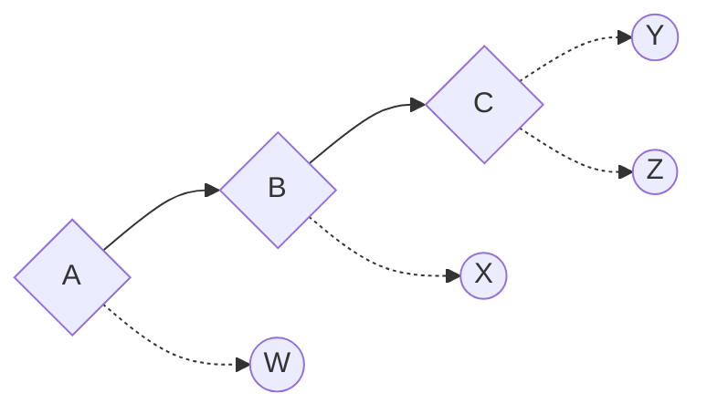
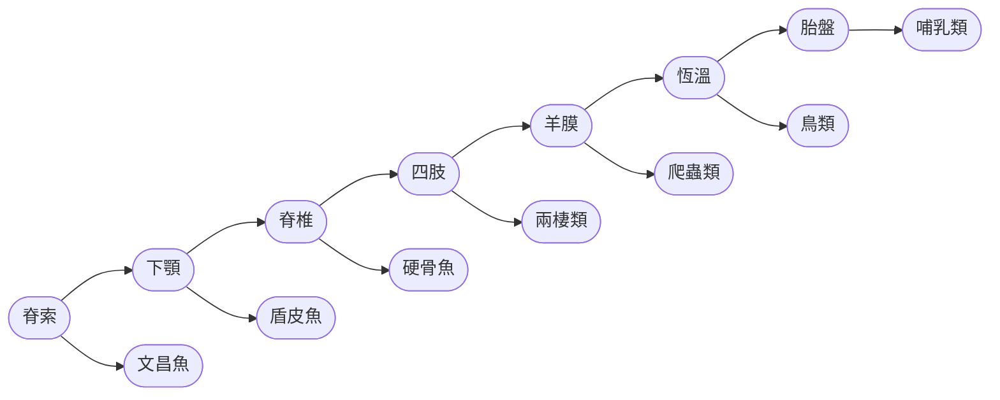
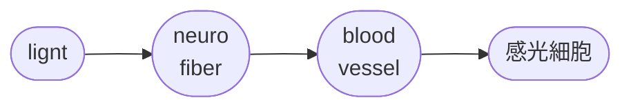
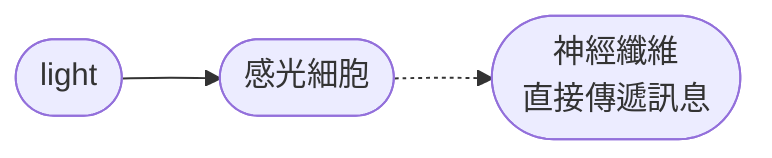
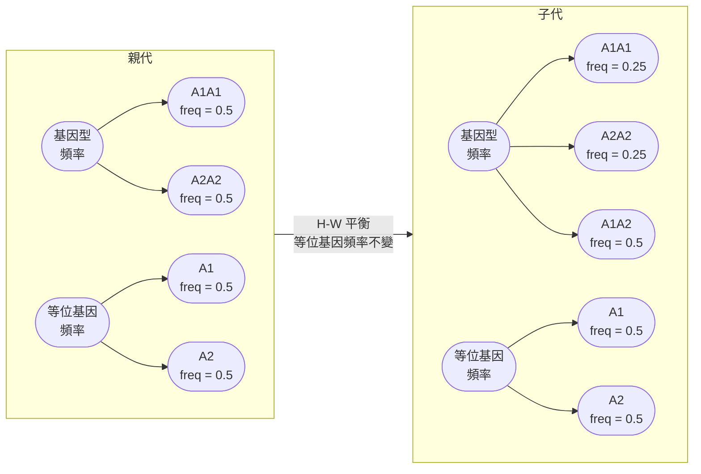

# Evolution 1st note
## chapter 1
### milestone of evolutionary biology
#### Goethe

> [!Tip]
> - 提出一個假設: 花其實是modified的葉子 😗
> - **他寫的植物變形記 (the metamorphosis of plants) 出版於1790**，第一次提及這種看法

#### 文學家身分
- 德國人**Goethe**寫下浮士德以及少年維特的煩惱等世界文學
- 原本是學法律的他後來接觸文學和哲學
- 他也寫涵蓋解剖、地質、氣象的著作
- 1786年去義大利 (從政失利，做假護照跑掉) ，受到古典美學影響 (我懷疑它會自詡為藝術家)
- 他也發明了 **"形態發生學" (Metamorphosis)**


### 重點人物來襲
#### Lamarck
> [!Tip]
> - 認為生物會有可獲得性遺傳
> - 認為生物會變得越來越完美跟複雜 🙂

- 這個概念有一個重點: 他認為後天可獲得遺傳是 "我要就會有"
- 例如飛行如果比較適合現在的生物，那這些生物會自行長出翅膀
- 當然我們知道這很扯沒錯 🤣

#### Darwin
- 在西英格蘭1809年出生
- 父親 Robert Waring Darwin 是一名醫師，希望 Charles 也能走上醫學職涯
- 祖父 **Erasmus Darwin** 是醫師、博物學者與思想家，曾提出涉及生物變化的早期推測
- 外祖父 **Josiah Wedgwood** 是著名陶瓷企業家
- 但是長大後，由於醫學系 (愛丁堡) 失利所以被父親提議上完神學 (劍橋) 後當牧師 🙂
- 主要原因是他曾目睹當時沒有現代麻醉與抗菌技術的手術，這段經歷尤其令他難以承受 😱😱
- 去劍橋後參加該社團，結果就是上山打獵遊玩，吃野味還會記錄好不好吃，例如蜥蜴或是鴕鳥等

> [!Tip]
> - Father: 遊手好閒的不孝子，你會為家族蒙羞 💀💀

- 他對植物學、地質學和自然史的興趣遠超過神學。劍橋的植物學教授 John Stevens Henslow 成為他的重要導師，並推薦他參與 HMS Beagle 的航行，為時五年


- 回國後Darwin 持續整理與比較標本，逐漸思考物種如何改變。他也受到地質學家 Charles Lyell 的思想，以及 Thomas Malthus 對人口增長與資源限制的討論所影響。
- 到 1838 年左右，他已開始形成自然選擇的核心想法，但沒有立即出版完整理論。他花了多年累積證據、研究變異與人工選擇，並與其他學者通信
- 1858 年，另一位自然學家 Alfred Russel Wallace 也獨立提出了相近的自然選擇想法。兩人的相關論述隨後在倫敦的 Linnean Society 聯合發表

#### Wallace
- 相較於Darwin，Wallace的背景就比較... 隨便

> [!Note]
> - 如果 Darwin 的人生像是「家境優渥的紳士青年，搭船出去考察，回來慢慢整理資料」，那麼 Alfred Russel Wallace 的人生就更接近...
> - 「家裡經濟出問題，十四歲左右就離開學校工作，後來靠測量工作、採集標本和賣標本維生，最後竟然獨立提出了自然選擇理論。」🤣

- 更慘的是，Wallace 把積蓄花光買工具 (一百英鎊)，與貝斯同行，前往亞
馬遜探險，返英途中船隻起火沉沒，幾乎所有標本與田野筆記都跟著葬身大西洋。所幸他和其他船員、乘客獲救 😭

### Sarawak Law
- Wallace在婆羅洲砂拉越 (Sarawak) 擔任詹姆士·布魯克（白人拉惹）的自然學助理時寫下發表於《Annals and Magazine of Natural History》
- Wallace 的「Sarawak Law」並不是法律，而是一個生物學原則...「每一個物種的存在，必然與一個先前存在的物種相連。」
- 簡單來說: 
   - 物種不會憑空出現，它們必然源自已有的物種
   - 物種之間存在時序性與地理性關聯
   - 這暗示了演化的連續性，但當時 Wallace 還沒有提出「自然選擇」作為機制

> [!Note]
> Wallace的理論似乎沒多少人看... 除了達爾文，因此達爾文就寫了信給他 (我終於找到同伴了嗚嗚) 🥲🥲

- 同時，Wallace 寫了另一個東西，也就是一份九頁的 "德納第文稿"
- Wallace把這本書的一部份寄給Darwin，即使這時候的Darwin從小獵犬號回來後，馬上和表妹結婚，然後... 躲起來，收租金維生 😗

#### 物種起源發表時
- 對於有共同祖先的這個論點，在神創論的年代，這根本就是邪門歪道 💀
- 但是確實引起很多學者的注意
- 提出的論點包含: 
  - 不同代的子女可能有些微差異
  - 特徵改變是漸近式的
  - 共同祖先
  - 族群量會有所變化
  - 自然選擇

> [!Important]
> - 1. 達爾文其實沒有遺傳的概念 !
> - 2. 拉馬克和達爾文在物種的起源想法中，**前者認為個個物種祖先是 "獨立的"，而達爾文認為是 "共同的"**


- 胡克及萊爾重讀達爾文1844年文稿，然後決定在倫敦林奈學會會議中發表
- 在這個paper發表的時候，其實Wallace和Darwin都沒有到，甚至別說沒到好了，Lyell和Hooker可以說是自作主張發表了 🤣

#### 分歧點在哪
- Wallace 跟 Darwin 最⼤的分歧處在於天擇理論應⽤在⼈類本⾝的解讀
- 例如，華萊⼠認為⼈類⼼智的演化無法以天擇解釋

> [!Note]
> - 「對於我們人類的精神和道德的發展而言，有一種超自然智能設計左右了變異的方向和尺度。」
> - 「除⾮達爾⽂能告訴我，這樣⼀個失去視力的黑人小孩，擁有潛在的⾳樂天賦，要如何在適者⽣存的定律下，對個體或群體在⽣存競爭中得利；否則我寧可相信應該有超脫於天擇的⼒量運作其中」😌
> -- Wallace

#### 後來發展
- 後來演化出新達爾文主義 (neo-Darwinism)，也就是演化學 + 遺傳學


---

## chapter 2
### 系統發育樹
- phylogeny 呈現出一組taxa的發育狀態跟演化歷史
- 由於系統發育的邏輯是從共同祖先延伸到多個子嗣，因此以 "樹" 的方式呈現
- 建構方式可以適用型態相似性，或是分子生物學數據

#### node
- 我們以以下的樹為例



- 其中，菱形的為**internal node** (也就是共同祖先，common ancestor)
- 而圓型的為**terminal node**，也就是後代
- 其中，裡面的A是這顆系統發育樹的**最相關共同祖先 (Most recent common ancestor, MRCA)**
- 而node之間的線條，就叫做lineage (或是branch)
- branch length可以是**代表時間** (也就是種化後經歷的時間)，或是基因間的差異


- 基因差異的話，length的長短可能不一


> [!Note]
> - 在tree裡面，node可以旋轉，因此即使旋轉後，也被視為同一棵系統發育樹 😗


- 有時候不一定可以找到共同祖先時，這種演化樹就沒有根，那branch長度往往代表基因間差異
- 假如說branch代表時間，而有一些terminal node並未延伸到現在的時間點，那就代表... 他滅絕了 🤣🤣

### 建構方式
- 可以用形態學或是分子生物學來建構演化樹
- 而且這些物種之間如果是類似的，**這種類似應該要是"同源構造"，而非 "同功構造"**


- 使用工具包含但不限於: 
  - Morphology 形態學
  - Anatomy 解剖學
  - Embryology 胚胎學
  - Chromosomes 染⾊體
  - Palynology 孢粉學
  - Nucleic acids & sequences 核酸序列
  - Genome 基因組

#### 種類
- 根據分支學方式，一共有三種分法
  - Maximum **parsimony** (高度簡約分析)
  - Maximum **likelihood** (最大似然性分析)
  - Bayesian inference (貝葉氏導出式分析)

> [!Tip]
> - parsimony = being stingy

- **Occam’s razor (奧卡姆剃刀)** 是一種推理原則，而在系統發生學中，Maximum parsimony正是運用這種思想來推斷演化關係的方法之一
- 它的核心思想可以概括成: 在能夠解釋觀察結果的不同假說之間，優先考慮所需額外假設較少的解釋
- 這裡的 razor 不是要把不喜歡的理論砍掉，而是**把不必要的假設 "剃掉"**


#### 定性跟定量分析
##### Fitch Parsimony
- 適用性狀：離散型 (unordered, discrete characters)，例如核苷酸、胺基酸、形態特徵。
- 假設：所有狀態之間的轉換成本相同，沒有方向性

##### Wagner Parsimony
- 處理的是有序性狀 (ordered characters)，也就是可以排成數字或等級的性狀。
- 例如：基因拷貝數 (0,1,2,3)、花瓣數 (3,4,5)、或某些形態測量值

> [!Note]
> - 在這種時候，你畫的演化樹，每一種改變的難度不一樣，所以要乘以相對的權重 (當然這個權重很主觀呵呵) 🙂

#### Dollo’s Law
- Dollo認為，**演化不可逆。複雜特徵⼀旦丟失，不容易再獲得**
- 想像你把一間房子拆掉...
  - 磚塊、木頭還在
  - 但要把它 "照原樣" 重建得一模一樣，幾乎不可能
- 演化也是如此。當一個構造消失後...
  - 控制它的基因可能累積突變
  - 發育路徑可能改變
  - 與它相關的其他構造也跟著演化
- 所以要走回原來的路非常困難

#### Dawkins的回覆
- 他認為說，Dollo's Law 並不是宇宙中存在某種 "禁止演化回頭" 的神秘力量
- 它只是說: 要把演化歷史一模一樣重走一次，在統計上極度不可能。也就是說，**在給定無數可能路徑後，恰好走回原路的機率非常低**
- 當然，同樣概念，**在統計上，不只是回到過去很難，其實任何指定路徑都很難**
- 例如，假設你在五億年前問 "人類會演化出來嗎"，答案是 "機率很低，不一定"

> [!Tip]
> - A → B → C → D 機率很低
> - D → C → B → A 機率也很低 🤣

### 讓我們來做實驗
- 第一步就是找出最早出現，也就是最普遍的特徵，也就是 "這個表格裡面，哪個特徵最早出現？"
- 假如說，下圖的部分，只有lancelet沒有脊椎骨，其他都有，那就把lancelet作為所謂的outgroup
- 等到確定outgroup後，再找下一個共享衍徵，以此類推

> [!Tip] 
> - 所以主要決定構造是否最大簡約的，就是共衍徵，最好把所有同樣的性狀變成synapomorphy


> [!Warning]
> - 首先要先知道一點，在這張圖裡面，我們不會說 "Lamprey是Bass的祖先"，而是會說Lamprey只是較早分家的堂兄弟
> - 所以黑猩猩不是你的祖先，只是分家的親戚 🤣🤣

### 核甘酸的改變principle
#### Jukes-Cantor (JC69) Model
- 1969 年由 Jukes 和 Cantor 提出
- 最重要假設就是: **四種鹼基完全平等，A = T = G = C**，而且任何替換機率都一樣

##### Rate matrix

$$Q= \begin{pmatrix} -3\alpha & \alpha & \alpha & \alpha\\ \alpha & -3\alpha & \alpha & \alpha\\ \alpha & \alpha & -3\alpha & \alpha\\ \alpha & \alpha & \alpha & -3\alpha \end{pmatrix}$$


#### 2. Kimura 2-Parameter (K80)
- 1980 年 Motoo Kimura 提出。
- Kimura 發現，Transition 遠比 Transversion 常發生。所以把替換分成兩類: 

##### Transition
- 也就是同類型互換
  - Purine ↔ Purine，A ↔ G 
  - Pyrimidine ↔ Pyrimidine，C ↔ T

##### Transversion
- 也就是類型互換: 
  - A ↔ C，A ↔ T
  - G ↔ C，G ↔ T

##### rate matrix

$$Q= \begin{pmatrix} -(\alpha+2\beta) & \alpha & \beta & \beta\\ \alpha & -(\alpha+2\beta) & \beta & \beta\\ \beta & \beta & -(\alpha+2\beta) & \alpha\\ \beta & \beta & \alpha & -(\alpha+2\beta) \end{pmatrix}$$


- 當你在預測演化數時，我們無法確定這就是100%正確，因此往往會結點處 (node) 給出一個機率
- 節點的數字就是可能在一起的機率 (或是terminal node關係的穩定度)


### clade 的概念
- 可以分為單系群、測系群跟多系群

#### Monophyletic Group
- 也被稱clade，包含共同祖先以及全部後代
- 例如哺乳類，就是一個完整的clade

#### Paraphyletic Group
- 包含祖先，但沒有包含全部後代，也被稱為測系群
- 也就是 "祖先有收，但部分子孫不收"
- 例如傳統的Reptile，蜥蜴恐龍鱷魚都收了，但是沒有收鳥類

#### Polyphyletic Group
- 也就是成員來自不同祖先，卻被硬湊在一起
- 例如飛行動物放一起，包含蝙蝠、鳥、昆蟲等等
- 以及猛禽 (raptor) 應該算是多系群


### 特徵種類
#### ancestral character
- 也被稱為 Plesiomorphy
- 指的是某個特徵在共同祖先身上就已經存在，並被後代繼承下來
- 例如，羊膜是**amniotes的祖徵**

#### derived character
- 也被稱為Apomorphy
- 指的是在**演化過程中新出現的特徵**
- 例如，羊膜是tetrapods的衍徵

#### Synapomorphy
- **某祖先新演化出的特徵，並被其後代共同擁有**
- 例如在羊膜動物中，羽毛是鳥類共有的，所以羽毛是鳥類的共衍徵

#### Haplotype
- 指的是 一群位於同一條染色體上、傾向一起遺傳的 DNA 變異組合

##### 例如
- 假設某段染色體有 3 個 SNP（單核苷酸多型性）：

| 位置   | SNP1 | SNP2 | SNP3 |
| ---- | ---- | ---- | ---- |
| 染色體A | A    | G    | C    |
| 染色體B | T    | A    | T    |

- 因為人有兩套染色體: 
  - 父系染色體：A-G-C
  - 母系染色體：T-A-T
- 則:
  - A-G-C = 一個 haplotype
  - T-A-T = 另一個 haplotype
- 這兩組變異會一起傳給後代


#### paralogous and orthologous
- 此處是alpha出現了重複 (duplication)，變成alpha跟beta
- 然後經過種化 (speciation) 之後，這基因alpha繼續演化成alpha1跟alpha2，而beta變成beta1跟beta2
- **Orthologous (直系同源)** 和**Paralogous (旁系同源)** 都屬於 homologous genes（同源基因）
- 意思是它們來自同一個祖先基因，但形成方式不同

> [!Tip]
> - Ortholog = 因為物種分化（speciation）而分開
> - Paralog = 因為基因複製（gene duplication）而分開 🐱


- 最典型的例子就是 $\alpha$ -hemoglobin跟 $\beta$ -hemoglobin，以及 myoglobin 的關係
- 所有球蛋白都有共同祖先，然後後來先衍生出肌紅蛋白 (outgroup)
- 之後，dublicate出 $\alpha$ 和 $\beta$ 然後不同物種就有不同的 $\alpha$ 和 $\beta$ ，甚至 $\alpha$ 和 $\beta$ 自己也會有內部複製
- 可以在裡面同時發現一些假基因 (pseudogene)


#### 性別bias
- 這是有關於**female bias跟male bias**，也就是哪個物種的sex較多
- 為啥XY偏向female bias，ZW偏向male bias? 這**可能是因為染色體出現degrade導致的現象**，如圖: 


#### 分子鐘
- 透過分析一個變異需要出現多少年，然後把變異的幅度才預測這東西是在何時出現演化的，公式如下: 

$$D=2rt$$

  - D = 序列的整體變化幅度 (看base pair的不同步)
  - r = 變異速度 (變一個base pair要花多少時間)
  - t = 祖先起源到目前物種的演化時間距離
- 考古學家會使用化石證據來預測r跟t
- 例如，這是根據cyt c的基因做定序來做所謂的分子鐘分析


#### 系統發育分析困難點
- 常常出現homoplacy 現象
- 不同位點的變異速率有所不同
- 不同譜系的發展速度可以差很快
- genetic tree $\ne$ species tree，基因相似並不代表一定是物種相同
- 要是遇到雜交跟水平基因移轉會非常困難

#### Homoplasy
- 也就是**非同源相似性**，例如大戟跟仙人掌長超像
- 這也就是趨同演化或是同功構造


- 通常分為三種: 平行演化、趨同演化、二次喪失
- 在講平行演化時，並沒有一個前提，認為一群有共同祖先的類群，但是convergent有共同祖先，只是會強調這並非同源構造
- 而**secondary loss**就是因為有一兩個物種的該特徵消失，例如魚類整體家群理論上都是硬骨的，但是鯊魚是從硬骨魚中丟失該構造
#### volutionary reversal
- 演化逆轉指的是... 一個生物譜系**在演化過程中失去或改變的特徵，又在後代中重新出現，或者演化方向回到較接近祖先狀態**

> [!Tip]
> - 祖先狀態 → 演化出新特徵 → 又演化回去
> - 例如節肢動物，原本沒翅膀，後來昆蟲綱產生翅膀，然後衣魚又喪失翅膀 🤣

#### 點突變的變異速率差
> [!Note]
> - **synonymous**就是silent mutation
> - **nonsynonymous**就是missense mutation

- 由於wobble effect，codon的第三個核甘酸變異的速度可以很快
- 但是第一或是第二個核甘酸由於變化後很容易導致錯義突變，**基本上演化會變得極度保守 (畢竟變異過的通常都活不下去)**


- 也由於密碼子的特性，每一個鹼基的變異速度根本不一樣，而且在嚴酷環境下，可存活的物種會出現大量基因差距不一的個體
- 這就是**輻射演化**


- cichlid fish就是其中一個例子，非常多相似但顏色不同的魚同時出現

#### 基因樹和物種樹往往不一樣
- 通常來說，假設某個祖先族群裡有兩種等位基因: A跟B
- 因為族群內存在多型性（polymorphism），所以每個個體攜帶的 allele 不同
- 後來產生了種化，變成了物種X、Y
- 如果經過很多世代，X 最後只剩 A，Y 最後只剩 B

> [!Tip]
> - 這種把祖先的變異慢慢篩選掉的過程，就叫 Lineage Sorting

- 不完全譜系分析出現的原因，往往是因為有時候物種分化太快了
- 祖先根本還沒來得及把 A、B 分開固定，然後大家就迅速分家，可能跑著跑著，我大猩猩的基因還沒被篩掉，就種化成人類，然後黑猩猩可能先篩掉了大猩猩的基因
- 這就會得到一個很可笑的結論: 

> [!Tip]
> - 黑猩猩先分化出來，然後我們跟大猩猩是親戚(人: 我只是他媽沒丟掉而已 🙂)


- 解決這東西的方式也很粗暴，單一基因會被 ILS 搞亂，那我就看 1000 個基因，去找一個變化平均值
- 以下的示意圖來自於對bonobo，chimps跟human的研究[^1]


[^1]: https://www.nature.com/articles/nature11128

#### 水平基因移轉
- 這可以說是最頭疼的，因為細菌就是用這種方式影響他的演化


- 甚至除了細菌之外，連海蛞蝓都能因為水草的基因得到好處!!

##### 海蛞蝓介紹
- 這種海蛞蝓會吃一種黃綠藻 Vaucheria litorea，但牠不是把藻類全部消化掉，而是把藻類的葉綠體保留下來
- 由於葉綠體本身攜帶的基因很少，在植物和藻類中，要維持葉綠體正常運作，還需要許多位於細胞核中的基因來製造蛋白質
- 不過目前不知道海蛞蝓是不是真的有把海草等基因嵌入自己的genome，但是很明顯他確實讓葉綠體活得挺不錯


---

## chapter 3
### before we start the class...
- 蛇的嘴巴非常神奇，上下顎還有方骨連接，可以把下顎延伸，而且還有彈性的韌帶
- 這屆世為什麼他可以吃掉袋鼠... 🙂

********

### let's get started !
- adaptation: 生物體在世代交替過程中，透過改變影響族群中的個體差異，使其在生存或是某些特徵上得到改善
- selection: 由於選擇優勢而在族群中普遍存在的特徵

#### Pleisomorphy vs Apomorphy
> [!Tip]
> - **Plesiomorphy (祖徵、原始性狀)** = 老祖宗就有的特徵
> - **Apomorphy (衍徵、衍生性狀)** = 後來演化出來的新特徵

- 例如我們以一顆模擬的樹為例: 



- 對於羊膜動物來說，祖徵就是下顎跟脊椎，以及羊膜
- 衍徵就包含真獸類的胎盤，或是有袋類的育兒袋

### darwin怎麼看?
- 首先我們知道演化有幾個條件: 
  - 生物體的特徵會隨著時間改變
  - 相關子代會來自同一地方
  - 漸進式的，可能需要好幾世紀
  - 同時在演化時，族群的人口會交替，以及大小改變
  - 同時，特徵要能遺傳，並且族群受到生存壓力
- 還有，**達爾文自己覺得人是不可能看到演化的** 
- 當然，這已經被社會科學家推翻了 🤣🤣

#### 紅肩美姬緣蝽
- 在原本的環境裡面，他們以虎燈籠的果實汁液為食，但是因為這些果實非常膨，因此他們的吸食器就特別長
- 雖然原本的嘴巴很長，但是他們遷移到台灣欒樹時，扁扁的果實讓它們很快就可以吸到汁液
- ... 然後就發現**嘴巴變短了** 🙂


#### Fritillaria delavayi (梭砂貝母)
- 原本是青綠色的植株，因為被過度採摘，最後在自然選擇下，植株的顏色開始篩選的，變得跟石頭顏色類似，避免被採摘
- 被大量採摘的主要原因是它的地下鱗莖是中藥材「貝母」的重要來源之一，被用於止咳、化痰等傳統藥材
- 問題在於：
  - 這種植物生長在中國西南高海拔山區
  - 生長速度慢
  - 要長到數年後才會形成可採收的鱗莖
  - 公斤藥材大約需要 3500 多株植物的鱗莖
- 所以它開始「隱形」了 🫥
  - 原本的梭砂貝母是 🟢 綠色葉片，🟡 黃色花
  - 但研究者發現，採摘壓力大的地區，植物逐漸變成 🟤 棕色，⚫ 灰色 (看不見我看不見我看不見我)


> [!Note]
> - 研究團隊發現，採收壓力越大的地區，植物的偽裝程度通常越高，認為人類採集行為是演化出這種保護色的重要原因 😗


#### 北美大角羊, Ovis canadensis
- 由於獵人喜歡打大角公羊，作為 **Trophy Hunting** (戰利品狩獵)
- 結果... 角竟然變得越來越小，因為...
  - 大角 → 先被射死
  - 小角 → 活得比較久 → 較有機會繁殖
- 可以發現，演化可以因為**外界環境的影響而快速演化 (尤其是當人類出手時)**

> [!Important]
> - 達爾文覺得自己看不到，我們馬上打臉 🤣
> - 以下的演化樹是用sequencing得到的 "病毒演化"，這些病毒株的演化速度超快 😲


### fitness
- 適應度，可以想成一個個體產下的子代變化
- 也就是這種性狀到底可以保留多少小孩 😏
- 前提包含: **fitness 在物種間有所不同、phenotype可以傳給下一代**
- fitness越高，曲線上升速度越快

#### 天擇不等同於演化

- 例如族群中等位基因頻率 (allele frequency) 隨時間改變，**這種東西就已經是演化了**，至於會不會有天擇，又是另一回事
- 還有一個就是genetic Drift（基因漂變），想像一個小島只有 10 隻鳥，天打雷劈後死掉的剛好都是帶 a 的鳥。 allele frequency 改變了，但不是因為a鳥有什麼特殊能力，而是因為他運氣好 (還是運氣差? 💀🤣)
- 突變也不是演化，得要有環境這個因子的幫忙

> [!Tip]
> - ~~Because of the need to adapt, evolution occurs~~ ，不要搞錯了 !
> - 不要說 "長頸鹿因為需要吃高處葉子，所以脖子變長"
> - 而是說 "長頸鹿祖先的脖長本來就有變異。有些個體脖子較長，在食物有限時能取得更多葉子，因此留下較多後代。經過許多世代後，長脖子的性狀變得越來越普遍"

#### Selfish genetic element
- 一段基因不一定對宿主有好處，但很擅長讓自己傳下去
- 這個實驗是在秀麗隱桿線蟲 (*C. elegans*) 的 sup-35/pha-1 系統
- 研究發現: 
  - sup-35 = toxin (毒素)
  - pha-1 = antidote (解毒劑)
- 而且這對基因會一起遺傳

#### 實驗開始
- 它們拿了兩種線蟲，而且兩個基因在 chromosome III 上彼此靠近
- **Hawaiian strain**
  - sup-35 (-)
  - pha-1 (-)
- **Bristol strain**
  - sup-35 (+)
  - pha-1 (+)
- 雜交之後會產生 TA/- 的雜合子，並且都存活 **(TA代表解毒劑跟毒藥基因都有)**
- 接下來讓F1自交產生F2，狀態就會是...

##### Punnett square：

|	|TA	|-|
|---|---|---|
|TA	|TA/TA|	TA/-|
| - |TA/-|-/-|

- 我們可以看到， `-/-` 就是Hawaiian strain
- 對於有Bristol strain基因的媽媽來說，她會在排卵前就將sup-35毒素注入這些卵中
- 也就是說，雜交後，有TA的個體可以活，但是 `-/-` 就會在胚胎裡毒死，這基本上就是 "媽媽把孩子毒死了"
- 也就是說，`-/-` 可以活，但是前提是他媽媽也是 `-/-` 才行

> [!Tip]
> - **TA/TA**, **TA/(-)**, **(-)/TA** : 歐耶 😎
> - **(-)/(-)** : 🙂🙂🙂


> [!Important]
> - 有此可見，當沒有咽喉基因時，在自然選擇下，sup-35成為了毒性的基因，然後pha-1可以解毒
> - (但是wild type根本沒這兩個基因，所以**為什麼要在實驗室做出兩個廢物** 🙂💀)

### Altruism
- 此實驗還要來自於一個芝加哥大學的情況說起...
- 實驗發現老鼠在看到另一隻老鼠被困住的後，會表現出強烈的不安感
- 而實驗人員開始把巧克力放在老鼠旁邊，另一邊是可移動的機關，看看他是先拯救同伴還是吃巧克力
- 結果如下: 

> "Though the free rat had the option of eating all the chocolate before freeing its companion, the rat was e**qually likely to open the restrainer containing the cagemate before opening the chocolate container.**"

- 也就是說，老鼠並沒有因為有了巧克力，就只選擇巧克力，展現出有趣的利他行為 (altruistic behaviour)[^2]


[^2]: https://news.uchicago.edu/story/helping-your-fellow-rat-rodents-show-empathy-driven-behavior

#### kin selection
- 演化不只是在保護「自己這個個體」，而是在保護自己攜帶的基因。
- 幫助自己生小孩 → 傳遞基因
- 幫助攜帶相同基因的親戚生小孩 → 也是在傳遞基因
- 公式就是: 

$$rB>C$$

- 也就是親緣係數 $r$ 乘以接受者獲得的利益 $B$ ，大於幫助者的利益 $C$
- 因此，在蜜蜂的例子裡面，「幫媽媽養妹妹 (r = 0.75)」比「自己生孩子 (r = 0.5)」更有基因利益，那乾脆工蜂就負責幫忙把妹妹跟媽媽都養好 😗

#### Group selection


- 首先，以上的圖A的邏輯在於: 
> [!Tip]
> - 「你個體可能很爽，但如果大家都只顧自己，整個團體可能死掉。」

- 例如很簡化地想：
   - altruist：「我少拿一點資源，讓大家一起維持系統。」🤔
   - selfish：「干我屁事，我先把資源吃光。」🙂
- 如果只有少量 selfish，問題可能不大
- 但如果整個 group 都變成selfish
- 就可能導致資源過度消耗 → group collapse → 整群死亡

#### Individual selection
- 如果我們單看群體中的個體，很明顯的，這種群體內個體間競爭 selfish其實更容易活
- 這會讓該群體內的selfish allele比例增高

#### 物種選擇
- 某種 species-level trait 是否讓這個 species 比其他 species 更容易存活、產生新 species，或避免滅絕
- 這用演化樹來看其實很方便
- 如果一個物種更容易 speciate (種化)，或更不容易 extinct，那麼攜帶這個 trait 的 lineage 在系統發育樹上就可能越來越多

> [!Tip]
> ##### 用一句話來形容: 
> - **individual是個體間競爭**，相對來說，selfish的基因更能生存
> - **group是群體間競爭**，相對來說，altruistic的基因更能生存
> - **species是物種間的競爭**，要取決於種化速度跟滅絕的機率

#### preadaptation
- 意思很簡單，就是一個原本因為 A 功能而存在的 trait，後來運氣好的可以被拿來做 B 功能
- 例如原本只是用來保暖防水的羽毛，變成了輕便而且可以提供抬升力的翅膀構造

#### exaptation
- 也就是一個原本不是因為「現在這個功能」而演化出的 trait，後來被挪作他用，而且這個新用途對 fitness 有利

> [!Note] 
> 例如，企鵝等鳥類的翅膀變成了類似魚的肉鰭構造，被稱為flipper (鰭狀肢)

|比較|Preadaptation|Exaptation|
|---|---|---|
|差別|原本的 trait **碰巧**已經具有某個未來環境可以利用的特性|這個既有 trait 後來被 co-opted，用於新的生物學功能|

#### 演化並不一定是為了適應
- 例如可能是物理或是化學造成的影響，不影響生存 (例如眉毛很長這樣沒優勢的trait)，但依然傳給下一代
- 例如，白翅山鴨的眼睛因為血紅素而呈現紅色，這對他的生存可能沒什麼影響，但是他有這個基因，也會傳給下一代
- 也有可能是遺傳漂變 (就是倒楣 🙂)
- **pleiotropy**，也就是基因多效性 (一個基因改變可以讓多性狀改變)，就是其中一個例子
- 可能你產生適應壓力的原因是A性狀，但是對應A性狀的基因也會影響B性狀，這時**B的改變就不是因為 "適應"**

#### 註: 鳥類的眼睛
- 下圖是鳥類跟人類眼睛的構造比對 
- 鳥類的 pecten oculi (梳膜) 是位於眼球內、從視神經乳頭附近伸入玻璃體（vitreous body）的一個梳狀、長在眼球內部、褶皺狀血管結構
- 鳥類的 retina 非常活躍，而梳膜因為是一個高度血管化的構造，因此可以快速提供氧氣
- 要記得一件事情，雖然是retina需要氧氣，但是不能因此將大量血管生成於retina，不然鳥根本看不到 (光被血管擋住)
- 最複雜的 pecten ，莫過於猛禽的眼睛


### 適應的其他例子
#### 葉子表面積
- 葉子小的植物，通常有兩個原因
  - 小葉子比較不容易散失熱量
  - 還有一個問題，就是水源。較低氣候的植物會減少葉子表面積，減少水分散失

#### 授粉方式
##### 蜜蜂授粉
- 花色以黃、藍、紫等常見
- **花形較開**
- **氣味較多**，花蜜相對好取得
- 適合讓昆蟲降落

##### 蜂鳥授粉
- 花色以紅、橘、粉紅常見
- **花形較細長，呈現管狀**
- 通常不依賴香氣，花蜜位於深處
- 適合**蜂鳥懸停 (hovering) 取蜜**

### 演化 = 完美?
> [!Important]
> - 演化不是追求完美，而是追求「夠用就好」🐱

- 由於能量或是養分的受限，並且遺傳是屬於共同祖先的延伸 (就像你不可能突然長出蝴蝶翅膀)，因此**自然選擇不會篩選出完美的物種**

#### 演化沒有終點
- 如果演化的目標是完美，那應該會有終極物種、最佳設計、最終型態
- 然而由於物理 (如重力或是散熱) 或是化學 (例如代謝) 上的限制，現實中根本不存在。例如:
  - 鯊魚已經存在約4億年
  - 水母超過5億年
  - 馬蹄蟹超過4億年
- 牠們完全沒變成人類，也就是以前大多數如認為的 "完美物種" (簡直是扯淡 🙂)
- 自然選擇只**在乎當下能不能留下後代，不在乎你的 "等級"**

#### 如果追求完美，眼睛不該長這樣
- 最經典的案例就是脊椎動物眼睛，因為他們的視網膜是反著裝的
- 光線穿過的第一層不是感光細胞，而是: 



- 這導致了盲點 (blind spot) 的存在，因為視神經要穿過視網膜
- 相反的，無脊椎動物，如章魚的眼睛: 


- 由於章魚的神經線在後面，沒有盲點，設計上面似乎更合理
- 所以... 如果演化＝完美設計，那脊椎動物眼根本不及格阿 🤪

#### 人類身上一堆爛設計
- 例如智齒，由於現代人顎骨縮小，但是牙齒尺寸沒同步縮小，結果導致阻生齒
、發炎
- 還有腰痛問題，人類從四足變兩足，原本直的脊椎變成... S 型，然後還要去承受垂直重量，導致椎間盤突出、下背痛
- 生產困難也是問題之一，由於在演化中，人類同時追求 **大腦變大 & 骨盆適合直立行走**
- 結果互相衝突，導致嬰兒頭太大，骨盆又太小，造成高風險分娩

#### 最重要的是這個 !!
- 演化只能修改舊零件，不可能無中生有 (除非你特麼是細菌)
- 工程師可以全部重做，演化不行。演化像**接手一個幾億年的祖傳程式碼庫**，所以只能...

```python
# version 1
do_A()

# version 2
do_A()
do_B()

# version 15
do_A()
do_B()
do_C()

# version 48
if weird_condition:
    do_old_A()

# version 92
# 不知道誰寫的
# 但刪掉會死 🙂
```

- 最終就只能**得到許多彎路、補丁、奇怪結構的義大利麵代碼，而不是最佳方案**

### 競爭導致了甚麼?
- 如果相似的物種共同存在，並且使用相同資源，就會**導致競爭**
- 如果使用的資源有不同，這會使競爭變少，**而使兩個群體間逐漸產生差異**

> [!Tip]
> - 環境改變 → 自然選擇 → 多樣性改變

- 在下圖A圖中，可以看到，當不同物種住在一起時，彼此的性狀受到 selection 而變得**更加不同**
- 因此鳥喙的長度也在產生越來越明顯的差異

> [!Note]
> - 這個概念可以延伸到種化的形成


- 而在B圖中，這個島上原本住著**Geospiza fortis**
- 後來出現乾旱。乾旱導致種子或是果實的質地開始轉向偏硬，以保護種子
- 這種環境變化導致了**Geospiza fortis 的鳥喙 (bill) 較大的被偏好，也就是directional selection**


- 事情還沒結束，後來乾旱逐漸結束
- 同一時間，**大型地雀 G. magnirostris 到達這個島**，它的喙非常大。所以它主要吃大型、硬的種子。這導致這倆傢伙開始搶同一批資源
- 這時就導致了**物種之間的差異變的更大**，彼此的性狀受到 selection 而變得更加不同

---

## chapter 4
### 前情提要
- **allele**: 也就是等位基因，可以用符號表示，例如A (dominant)、a (recessive)
- **genotype**: 在一個物種的基因座上，兩個等位基因的組合。例如AA、aa (homozygous)、Aa (heterozygote)
- 在**哈溫平衡**的情況下，無論子代表現型如何，基因池裡，每個等位基因的頻率都會跟親代相同
- **但是 !! 基因型頻率可能會變，這點要搞清楚**
- 我們舉個例子: 



- 你發現，基因池的allele頻率沒變，但是子代的genotype變了 😲

#### Hardy-Weinberg equilibrium
- 以剛剛的A1、A2兩個allele為例子，假設 $p$ 為 A1 頻率， $q$ 為 A2 頻率 ，計算它們產生的genotype的方法，大概是: 

$$
\begin{align}
& p + q = 1\\
& A1A1_f=p^2\\
& A2A2_f = q^2\\
& A1A2_f = 2pq\\
\therefore\quad & \boxed{p^2 + 2pq+ q^2 =1}
\end{align}
$$

- 要達成這個平衡，需要有以下幾個條件: 
  - 無自然選擇壓力
  - 族群規模可以看成無限大
  - 隨機交配，不挑人
  - 沒有基因突變
  - 沒有外來基因流入
  
#### 如果前提條件沒有成立的話: 
- 要是突變產生: 有些基因出現缺失或是重複，甚至在基因池裡面突變出新的基因
- 非隨機交配: 這樣隨機配子的結合就不會發生，基因池的等位基因頻率可能不會變，但是genotype頻率一定會變
- 自然選擇發生: 透過適應性，可能篩除某些不適應該環境的個體，使其基因無法傳到後代，進而導致基因池的allele頻率出現改變
- 小小群體: 小群體的基因池相對於大群體，更容易變動，這也被稱為遺傳漂變
- 基因流動: 這不用說了，直接在群體裏加入其他外來群的基因，allele頻率當然會變

#### descent with modification
- 原有共同祖先，之後物種的差異性逐漸累積，直到他們能夠適應所棲息的不同環境
- 這也叫做**descent with modification**。也就是共享同一特徵，但是各自有差異性，例如此處講的就是螳螂。這三種螳螂都**享有和祖先相似的特徵 (例如鋒利的前肢、三角形頭部)**，但是體色 (**Camouflage，顏色偽裝**) 不同


### 計算開始了
#### 自然選擇舉例
- 咱就以鐮刀型貧血為例， $A$ 為正常allele， $S$ 為鐮刀型貧血allele，在研究者觀察到的數據中，樣本如下: 

$$AA = 400, \quad AS = 249, \quad SS = 5$$

- 因此根據觀察， $AA$ 的比例是: 

$$AA_f = \frac{400}{400+249+5} = 0.612$$

- 但是，如果以哈溫平恆來預測，理論上來說: 

$$
\begin{align}
& A_f = \frac{400 +\frac{249}{2}}{400 + 249 + 5}\approx 0.8019
&\therefore AA_f = 0.8019^2 \approx 0.643
\end{align}
$$

- 也就是說，genotype比例跟HW平衡預測的比例不合
- 再繼續計算，可以發現，同型合子的genotype (AA、aa) 頻率普遍較低，而異型合子(Aa) 偏高一點
- 其實這跟malaria有關，研究發現，出現S形紅血球的人，似乎對瘧疾有比較好的防禦力
- 這也因此導致了Aa的比例偏高: 既維持部份正常血球量，也比完全同型合子的健康人更容易抵禦瘧疾


#### recombination
- 重組率基本就是看重組的genotype個體，佔所有個體的比
- 重組率最高到50%。咱們舉AB × ab為例
- 假如說兩個位點雖然有連鎖，cross over很常發生，那產生的配子最多也就是: AB、Ab、aB、ab，各25%，這跟獨立分配率根本就差不多了

> [!Note]
> - 分摩根 (cM): 1%的重組率 🐱

#### 甚麼是LD
- **LD = linkage disequilibrium**，連鎖不平衡
- 在這裡，你可以LD理解成: **兩個 loci 的 allele 是否 "異常地常常綁在一起"**，也就相當於在觀察上，連鎖的強弱 (額，對，**並不是說他們一定連鎖，而是說他們 "看起來" 連鎖的機率**)
- 然後我們開始加入recombination，這時由於基因的交叉互換，會觀察到兩個allele似乎沒有綁這麼緊了，這時LD就會下降
- 而只要**r (互換率) 越高，在世代遺傳時，LD消失的速度會越快**


- 下圖為一張LD heatmap
- 橫軸跟縱軸都是代表基因在染色體上的相對位置，單位為kb
- 我們可以看到，A基因跟B基因相距50kb，而B基因跟C基因相距250kb
- 所以至少我們知道，AB距離短，BC距離遠
- 這個heatmap之所以形成一個對角線的樣子，主要是因為對角線代表的就是A跟A的連鎖率，或是B跟B的連鎖率 (答案就是用膝蓋想都會是LD最高，因為根本沒意義阿XD)
- 接下來就是做對比，可以發現在橫軸A縱軸B，或是橫軸B縱軸A的交點區域特別紅，這代表此處LD高
- 相對的，如果是橫軸B縱軸C，或是橫軸C縱軸B的地方，則是幾乎一片空白，這代表此處LD很低


#### 「促進異花授粉（outcrossing）」機制
- 這裡有兩種常見的，而且適應度較高的花朵基因型種類: Pin和Thrum
  - Pin是柱頭高，花藥低
  - Thrum是柱頭低，花藥高
- 我們把控制雄蕊長度的基因定義為A、a (A，長雄蕊，顯性)
- 而雌蕊長度的基因定義為G、g (G，短雌蕊，顯性)

> [!Note] 
> - 這兩種常見的適應型設計的目的，其實是 "為了避免自花授粉"


- 具體來說，就是高雄蕊的Thrum吸引昆蟲，然後昆蟲把花粉給Pin，完美
- 問題來了，recombination 怎麼辦? 你要是基因互換到出現gA/ga 基因，這時雄蕊跟雌蕊都很長阿
- 這就變得很尷尬，尤其是**報春花這種東西自花授粉常常出現incompatibility的限制**
- 因此這種基因互換即使存在，也會因為不適應而容易被淘汰掉


#### 近親交配的下場
- 咱們來講一個近親交配導致自交衰敗的例子... 西班牙王子查爾斯二世
- 這很明顯就是一個近親結婚導致身體出現狀況的最佳例子 
- 具體新鮮爛事包含: 哈布斯堡下巴畸形，發育遲緩、智力障礙、構音障礙、骨骼畸形、反覆感染、癲癇、不孕等等等等 🤪

> [!Tip]
> - 更多他的慘事報告可以[點開以下內容](https://pmc.ncbi.nlm.nih.gov/articles/PMC8477247/) 😏


### 考古時間
- 突變有分很多種，例如: 
  - 點突變: **靜默、錯義、無義、框移**突變等等
  - 染色體結構突變: **缺失、重錄、倒位、易位、染色體分裂 (fission)、染色體融合 (fusion)** 等等
  - 整個基因組複製: 也就是**多倍體**

#### Huntington's disease
- 亨廷頓舞蹈症是一種罕見的遺傳性疾病，會導致大腦中的神經細胞逐漸分解（退化）
- 嚴格上來說，HD的poly-Q不能算是duplication，其實更精確的突變狀況，叫做 Repeat expansion mutation，也就是寡核甘酸擴增，**poly-Q就是trinucleotide的重複 (CAG)**


#### 流蘇鷸的羽毛顏色
- 原本祖先型的雄性擁有深色裝飾羽毛，並在求偶場上與其他雄性激烈競爭交配權，然後發生染色體倒位
- 最初的倒位（黃色）大約發生在 380 萬年前（MYA），位於 11 號染色體上。這種又稱為 **"雌性擬態" (faeder)**
- 然後是祖先型跟faeder的雜交，大約在 50 萬年前，Faeder 等位基因和 Independent 等位基因之間罕見的重組事件產生了 **Satellite 等位基因 (粉紅色)**[^3]

> [!Tip]
> **倒位跟重組後的基因是純合致死的 (就是兩個黃色或是兩個粉色就會掛掉)**，而且倒位等位基因之間基本不會發生重組 (死亡率很高很高) 🙂


[^3]:https://www.frontiersin.org/journals/genetics/articles/10.3389/fgene.2021.641620/full

### mutation rate
- 不同物種間的變異率差很多
- 然後你會發現一件事情: 基因組越大，變異率越高。為什麼? 🤔

> [!Note]
> - 基因組大小越大，單一核苷酸突變率（per-site mutation rate）傾向越高

#### 可能解釋: Drift barrier hypothesis

> [!Tip]
> - 這是近年最主流的想法。核心概念就是 "DNA修復系統可以繼續進化得更精準，但精準是有代價的"

- 假設物種A有效族群大，例如細菌...

$$N_e=10^8$$

- 哪怕突變率只下降一點點，自然選擇都看得到好處，因此: 
  - 修復系統越來越精準
  - 突變率越來越低
- 而假如說是物種B的有效數量，例如很多脊椎動物...

$$N_e = 10^4$$

- 即使出現更厲害的修復蛋白：
  - 好處很小
  - 漂變 (drift) 就蓋掉了
- 於是突變率就繼續維持 (有本錢突變的概念)

> [!Important]
> - 這就是 drift barrier hypothesis
> 
> $$Genome\ size \uparrow\quad Mutation\ rate \uparrow $$


- 當然如果是病毒，那完全是另一回事，單股的基因甚至比雙股的基因更容易突變 😏


### effect of mutation
#### Pleiotropy
- **Pleiotropy (多效性)** 的標準定義就是: 一個基因 (one gene) 影響多個表型性狀 (multiple phenotypic traits)

##### FGFR3 mutation
- FGFR3 (Fibroblast Growth Factor Receptor 3，纖維母細胞生長因子受體) 編碼一種細胞表面的受體，負責接收 FGF 訊號，調控...
  - 軟骨細胞增殖
  - 骨骼生長
  - 細胞分化
  - 組織發育
- 其中最有名的是對長骨生長板 (growth plate) 的調控。FGFR3 就像骨骼生長的 "煞車器"
- 如果該基因突變，會導致 **Achondroplasia (軟骨發育不全)**
- 這種突變讓 **FGFR3 過度活化**，即使沒有正常訊號也會持續發出 "停止生長" 的指令
- 同一個突變可以造成：

|表型	|原因|
|---|---|
|四肢短小|長骨生長受抑制|
|身材矮小|骨骼整體生長減少|
|巨頭症 (macrocephaly)	|顱骨發育模式改變|
|脊椎狹窄|椎骨形成受影響|
|呼吸問題|顱底與呼吸道結構變化|
|反覆中耳炎|顱顏結構改變影響耳咽管功能|

> [!Important]
> - 所有的這些表現型，都來自同一個 FGFR3 突變 !! 😲😲


#### 突變會影響適應度
- **大部分的突變，通常對於個體來說是負面影響較多** (也就是**deleterious**，例如錯義突變、無異突變、框移突變)。極少數的才是有可能增加適應性的
- 基本上，無義突變是平均來說最有負面影響的
- 下圖中就是該圖便會影響的適應性狀態，如果 s = -0.1，就代表生存率降低10%
- 可以發現大部分的mutation， selective coefficient (s) 都是負的比較多


#### 突變在哪裡發生?
- **生殖細胞突變**導致的是子代有問題的機率增加，也就是說，生殖系的細胞突變，才有可能遺傳
- 體細胞的突變導致的是**個體癌症機率增加**，尤其是在碰到**致癌物質 (carcinogens)** 時，所以不會遺傳給子代
- 當人老化的時候，全身細胞的突變累積，會讓你這兩個倒楣事都中招 🙂

#### 突變是否隨機發生
- 科學家利用Replica Plating Experiment (複製培養皿實驗)，來驗證這一回事
- 他們先培養一堆細菌，然後複印菌株到不同培養皿，再加入病毒，看看那些菌株有抗病毒的突變
- 當時就有兩個假說: 
  - $H_1$ : 病毒來了以後， 細菌才產生抗性突變
  - $H_2$ : 突變在病毒感染細菌之前就已經隨機發生

##### 假如說 $H_1$ 是對的
- 那在複印菌株到不同培養皿，撒上病毒後，每一個 replica plates 之中的抗性菌落位置應該**每一盤都不同**
- 因為假說認為，抗性是病毒加入後才出現的，所以抗病毒突變應該亂七八糟的出現

##### 假如說 $H_2$ 是對的
- 如果母培養皿 (master plate) 其實已經存在少數抗性細菌，那它在轉印到其他 replica plate 後，每一盤都會在 "同樣的位置偵測到抗病毒菌株"

> [!Note]
> - 最後實驗驗證 $H_2$ **是比較正確的**，因為實際上，每一個 plate 的抗病毒菌株位置完全對得上
> - 這代表，這些抗性菌**早就在母盤裡存在了**。病毒不是造成突變的原因，**病毒只是找出誰已經有突變而已** 😗


---

## chapter 5
### 前情提要
- 在基因上，現代人的基因組其實有**包含一些尼安德塔人 (Neandertal) 的DNA碎片** 
- 可以發現說歐亞區域的個體，身上所含有的尼安德塔人的基因碎片較多


### 開始進入正題吧 😗
#### the story of peppered moth
- *Biston betularia* ，也就是胡椒蛾，是一種夜行性蛾，大部分的moth身上為白色鱗片，有深色斑點
- 另外一種翅色**Melanic**，翅膀非常深，甚至接近黑色


#### 然後工業革命來了
- 這導致了白色的地衣死亡 (酸雨) + 樹皮顏色被長期燻黑。這時候鳥類就登場了
- 由於Peppered moth 白天通常停在樹幹上休息，這些白色moth超容易被看到

> [!Tip]
> - black: I'm one with the tree. 😗
> - white: 媽的我怎麼這麼顯眼 💀

 - 這導致基因池的allele frequency改變，在族群本來就有 genetic variation的情況下，自然選擇篩選了適應度較強的

#### 第一隻 Melanic 的發現
- 1848年，當時是Edleston發現第一隻黑色的胡椒蛾
- 這其實就證明了在翅膀顏色上，該moth有基因多樣性，不是只有白色翅膀而已

#### 不了了之
- Albert Brydges Farn 是一位昆蟲學者
- 當時他研究的不是胡椒蛾，而是**Annulet moth (還原枝尺蛾)**
- 他觀察到一個很奇怪的現象，**同一種蛾在不同環境，顏色差異非常大**：
  - New Forest 的泥炭地：幾乎黑色
  - limestone：灰色
  - Lewes 的白色 chalk：幾乎白色
  - clay / 紅土：棕色
- 然後他好奇，這些變異是不是指向 **“survival of the fittest”**？
- 而他自己覺得自己的假說有點道理，**因此在 1878 年寄一封信給 Darwin**，但是... 

> [!Tip]
> - Farn：「Darwin先生！！！我看到一個超詭異的現象！！
>   - 不同環境 → 不同顏色
>   - 黑煙污染 → 深色蛾增加
> - 這是不是 survival of the fittest？！ 🤔😲」
> - 寄信後，**Darwin 完全沒有看到這封信**，所以他自始至終相信人是無法親眼看到演化的

#### industrial melanism
- 對 peppered moth (Biston betularia) 而言，工業黑化 (industrial melanism) 的正式研究和經典案例是在後來才逐漸建立
- 例如 **J. W. Tutt 在 1896 年才明確把工業環境與蛾的 melanism、自然選擇聯繫起來**
- 而那已經是 Darwin 去世之後了，很可惜錯過了這個時機

#### 為什麼顯眼的蛾會消失?
- 關於鳥類捕食胡椒蛾的說法，最早來自於 **J. B. S. Haldane** 這位學者
- 他研究胡椒蛾超過50年，在 1924 年提出一個假設，認為**黑色的胡椒蛾確實有更高的生存機率**
- 而這個變化的自然選擇前提，是**鳥類會捕食他們，因此成為演化的驅力**
- 只是當時還沒有人真正看到鳥把moth吃掉的畫面...

#### 親自把蛾放到樹上
- **Bernard Kettlewell** 在 1952 年，嘗試收集並飼養3000隻胡椒蛾
- 在它們身上標記記號後，把蛾放到樹上，記錄11天
- 也是在這期間，他宣稱自己親眼觀察到鳥類捕食胡椒蛾的畫面

#### 實驗質疑出現了
- **Michael Majerus** 在1998年，對於 Kettlewell 的實驗方式有一些疑問，例如...
  - 胡椒蛾又不是只會停在樹上，他可能會停在無法提供 camouflage 的區域
  - 胡椒蛾是夜行性動物，為什麼是被鳥吃掉，而不是蝙蝠等夜行性的捕獵者? 
  - 一次釋放高密度的蛾，真的沒有問題? 🤔

#### 指控造假
- 2002 年，科學記者 **Judith Hooper** 出版了 "Of Moths and Men" 這本書
- Hooper 並不否定演化，但是她質疑 Kettlewell 的實驗可能沒有那麼可靠
- 她提出諸多疑問，例如: 
  - 蛾是不是被放在不自然的位置?
  - 鳥的捕食是否受實驗設計影響?
  - 某些結果是否被過度解讀?
- 她甚至**指控 Kettlewell 造假**，認為對方是為了奉承上司，而進行的假實驗

#### 重新做一次實驗
- Michael Majerus 從懷疑 Kettlewell 的實驗流程，到自己開始**重新設計實驗** [^4]
  - 他改成利用 4864 隻 **"野外的，非飼養的"** 胡椒蛾
  - 並且不刻意把蛾放在樹上，讓他們 "自由發展"
  - 並且減少每次釋放的蛾數量，一個晚上只會放出 12 隻，並且實驗進行 6 年
- 他發現在環境逐漸從工業黑化恢復後，黑色的胡椒蛾數量下降，該基因的頻率也在40年內，從近乎100%下降到不到10%


#### 小總結

<iframe src="https://Jacklyn301.github.io/interaction_chart_with_AI/the%20story%20of%20peppered%20moth.html" width="100%" height="600px"></iframe>

[^4]: https://doi.org/10.1098/rsbl.2011.1136

#### 達爾文進城來了
- **Ilik Saccheri** 於 2016 年，在基因上面發現，黑色moth的出現是因為**cortex gene區域插入了轉座子導致**
- 並且以分子鐘等工具追溯，覺得這個轉座子的移位發生在1819年，**也跟工業革命對得上 !!** 😲


### 演化與統計學
- 如果說我們試著畫出一個座標圖，橫軸是父母的平均體長，在correlation上，子代平均的體長應該會和其父母的體長平均呈現正相關 (也就是爸媽越高，小孩平均越高)
- 然而，在篩選的條件下，由於某些體長的子代被偏好，他們基因池的allele頻率增加，例如，如果體長太短容易被淘汰，剩下少數的個體群平均下來，體長便會增加 (可以想像成，短體長的基因被淘汰掉了)
- 因此統計下，下一代的平均體長就會上升

> [!Important]
> - 這特徵需要有**一定的遺傳率**，若特徵被選擇所偏好，但是沒辦法遺傳，演化就無法發生 🐱


#### 適應度

> [!Important]
> - Absolute fitness (W) 問「你實際留下多少後代？」
> - Relative fitness (w) 問「你跟別人比，誰留下比較多？」

- 例如，如果等位基因Aa留下了4個子代，那W = 4
- 而relative，通常會**把各自的W相除**，通常分母以W最大的為主，所以w最大就是1
- 在數學上來看，大概就是這個樣子: 

$$w_{11} = \frac{W_{11}}{W_{11}}=1\quad w_{12}=\frac{W_{12}}{W_{11}}\quad w_{22}=\frac{W_{22}}{W_{11}}$$

- 大寫的 $W$ 就是absolute fitness，小寫的 $w$ 則是 relative fitness

### positive selection
- 最簡單的一種自然選擇概念
- 自然選擇偏好適應度較高的個體，而且沒有任何trade off的問題
- 這相當於該突變讓個體**獲得了單純的好處**

### 大型選擇性掃掠
- 在計算某個allele在基因池的頻率時，我們可以把不同基因型的relative fitness算出來
- 以 "不完全顯性" 為例，如果 $A_2$ 是能提升適應度的allele，那三個genotype的相對適應度分別是: 

$$A_1A_1=1\quad A_1A_2 = 1+s\quad A_2A_2 = 1 + 2s$$

- 在上一章我們提到了 $s$ ，selection coefficient，也就是描述的是一個性狀被prefer的狀況。
  - 如果s > 0，代表說此性狀讓該個體被偏好活下來
  - 如果 s < 0，代表說此性狀讓該個體被容易淘汰
  - 如果s = 0，代表該性狀並不影響個體的適應性 (痾，例如你的手指長度對於鬣狗的捕食情形? 🤣)

##### gene fix
- 該基因在非常強勢的情況下，沒過多久就會佔據大部分的基因頻率，進而壓縮其他的基因，使**整個基因池的多樣性下降**
- 可以看看該allele的一個頻率-時間軸，不同s會讓他頻率上升的速度不一樣，但是當最終**frequency趨於飽和 (100%)** 時，便完成了selective sweep，這時我們會說**該基因被 fixed**
- 可以發現，s越高，頻率上升越快，越早出現飽和


> [!Note]
> - 適應度高的allele被固定下來的時間 $\approx$ 4/s，這個時間尺度是以世代為單位。
> - 例如，如果s = 0.1，那該基因大概過了40代就會被固定下來

#### allele 演化的速度
- 在 $s$ 值較小的情況下，allele 的演化速度 $\Delta p$ 可以近似為: 

$$\Delta p \approx sp(1-p)$$

- 當p隨著時間變化，而s為常數時，可以發現， $\Delta p$ 最大的時候，其實是在p = 0.5時
- 無論A2的基因太多或是太少，基本上演化的速度相對會慢
- 如果把 $\Delta p$ 畫出來，你會得到一個倒U型的二次曲線 (不是常態分佈 !!)

#### 顯隱性的影響

> [!Tip]
> 同樣是一個有利的 A2 allele，為什麼它是不是 dominant / recessive，會讓 selective sweep 的速度差這麼多？ 🤔

- 這時就要提到剛剛的 relative fitness 問題
- 如果考慮了顯性隱性實際影響個體的適應度，你應該得到的相對適應度如下: 

|genotype| $A_1A_1$ | $A_1A_2$ | $A_2A_2$ |
|---|---|---|---|
|relative fintess, $w$ |1 | 1+hs| 1+s|

- 其中h代表我要測量的基因 ( $A_2$ )，到底表現多少 (在此處，h = 0、0.5、1)
  - 如果你的A2為顯性，那相對fitness應該就是1、1+s、1+s
  - 相反，如果是隱性，就是1、1、1+s


<iframe src="https://Jacklyn301.github.io/interaction_chart_with_AI/selective_sweep_explorer.html" width="100%" height="600px"></iframe>

- 在上圖中，三條線都以 "A2 是 beneficial allele" 為基礎，從非常低的 frequency 開始，最後接近 fixation 的狀態
- 唯一不同的是，A2 的 fitness effect 怎麼表現，也就是分成顯性、不完全顯性、以及隱性
- 可以發現它們的上升速度有所不同，**尤其是recessive有一個明顯的lag phase**，這讓 $A_2$ allele 過了很多代之後才顯現出其優勢

#### evolutionary trade-off
- **一個提升某種性狀適應的等位基因，可能會降低另外一種性狀適應**
- 例如較深的膚色有利於抵禦強烈 UV，但會降低 UVB 穿透皮膚，進而可能影響 vitamin D 合成
- **人類的膚色和SLC245A突變有關係**，如果膚色較淺，你確實吸收更多vitamin D，但是皮膚癌的風險上升

> [!Tip]
> - 魚和熊掌不可兼得 🐟🐻

- 還有一個例子就是**soay sheep**。他有兩個allele: $Ho^+$ 跟 $Ho^p$ ，分別代表長角跟短角
- 長角的羊更容易找到伴侶 (性擇)，但是命短，尤其是同型合子 $Ho^+ Ho^+$
- 而短角羊 ( $Ho^p$ ) 雖然不容易找到伴侶，但是有更高存活率
- 經過一番比對，**相對適應度最強的，就是 "異型合子"** 😲

#### hitchhiking
> [!Important]
> - 最大原因: **連鎖不平衡 (linkage disequilibrium, LD)** 😏

- 假如說條紋跟黃色的基因有連鎖，而粉色的蝸牛可能有條紋，也可能沒有
- 如果鳥類特別愛條紋蝸牛，在selection之後，你會發現只剩下粉色無條紋蝸牛
- 但**並不是因為黃色性狀不適合生存，而是因為黃色的蝸牛一定有條紋，而鳥類喜歡有條紋的蝸牛**
- 這也被稱為hitchhiking (搭便車效應)
- 所以，即使在自然選擇下，主要影響的是A基因，但是，因為B跟A有 **"連鎖" (D>0)**，這導致B基因的頻率也有所改變。 $\Delta p_B$ 被 $s_A$ 影響 !! 😏
- 因此，這時B基因的演化速率，就會變成: 

$$\Delta p_B \approx s_A D$$

> [!Note]
> B 自己沒有 selection，但如果它跟正在被 selection 的 A 有連鎖不平衡，那麼 **A 的 selection 可以間接改變 B 的 frequency**

#### 搭便車掃掠 (?)
- 由於連鎖效應，即使某個基因根本沒有影響fitness，他依然可能會在基因池裡的頻率增加。因為... **他旁邊正好有一個有利的突變**
- 然後他就在這個**突變基因的尊榮 (?) 下，一起增加allele frequency**，即使他根本沒有positive selection 的效果 😗


#### Corn domestication
- 當人類在**改良大芻草**的時候，偏好了**tb1 gene**，該基因會增加頂芽優勢，使**側枝大幅減少**
- 我們可以發現，相對於玉米，大芻草 (teosinte) 的 tb1 locus周圍的基因多樣性 (heterozygousity) 明顯更高，而**玉米幾乎為0**
- 也就是說，很多不同 maize 品系，在這一大段區域的 DNA 都非常相似，就是因為**人類刻意fixed這個基因，而周圍的序列也一起被fixed了**


### 常設型的遺傳變異

> 先想像兩種情況...

#### New mutation → hard selective sweep
- 假設某天突然出現一個 beneficial mutation，並且最開始只有一個 chromosome 帶著 A* ，所以 "A* + 附近的haplotype" 是 **"一整組綁在一起的"**
- 所以該基因附近會出現核甘酸多態性下降，基因多樣性下降，連鎖不平衡高，這種叫做 **"hard selective sweep"**

#### Standing genetic variation → soft sweep
- 假設A其實在population裡面一段時間，足夠recombination改變A附近的基因
- 或者是**A有透過拷貝讓自己變多**
- 當環境突然讓A變得有利時，多條原本帶著A的haplotypes被同時選中
- 這時就**比較不會出現 "一大段都一樣"** 的狀況，這種溫和的版本，也被稱為**soft selective sweep，或是常設型的遺傳變異**


### 三種遺傳的path
- 分為positive、overdominance、underdominance


#### overdominance
- **異型合子更被偏好**， $w_{12} > w_{11}\quad and \quad w_{22}$
- 這會讓**allele不可能sweep到接近100%**，在選擇中反而會偏好都保留
- 最後會達到stable polymorphism
- 平衡頻率的計算: 

$$p_{A2} = \frac{s1}{s1 + s2}$$

- 偏好去保留多樣性 (balancing selection)

##### 以鐮刀型貧血為例
- S的基因之所以到現在都還存在，很大原因是受到瘧疾影響，攜帶了S allele的基因比例，和瘧疾盛行區有所重疊
- S allele在瘧疾上更能抵抗 (沒錯，也是trade-off的一個例子 !!)
- 因此在選擇下，存活率最高的群體，其實是AS基因

##### 齒麗魚
- 他側邊的嘴巴攻擊其他魚類的體表，刮取小蟲或是藻類
- 有開左側跟開右側的
- 假如說多數魚為開左側，攻擊魚的右側，那這些魚會更警惕，避免被攻擊右側而偏向往左邊跑
- 這時，開右側嘴巴的齒麗魚就更能有機可乘

> [!Tip]
> 也就是說，每一次更有fitness的基因，就是那些frequency較低的allele 😏


#### underdominance
- **同型合子**更被偏好
- 這種時候去看allele的frequency會很有趣。如果A2很少，大部分的A2還在異形合子中，就會導致A2可能完全消失。但是如果A2很多，A2在基因池比例為100%的速度會比另外兩個更快上去
- 這時原本A2所在基因池的比例就超重要，**threshold為50%，過一半，你就會fixed，少一半，那你會消失 :-(**

> [!Tip]
> 所以說，對於allele來說，如果身處於positive，就算自己頻率低，又或者是屬於recessive，他總有一天還是會fix，但是**underdominance不一定，要看原先的頻率** 🐱

- 舉最簡單的例子，就是**物種的雜交**。很多雜交會導致出現合子後的生殖隔離 (也就是子代不孕)
- 還有一種就是擬態，假如說某種蝴蝶已經擬態成了另一種有毒的物種，這時的hetrozygous個體可能會因為 "跟別人不一樣" 而更容易被吃

##### 同時輸入跟刪除 （？）
- 假設我們有兩個 population (如 A、B 向日葵)，直覺上可能會覺得: 

> 「既然 A、B 還是一起生活、還是會交配，那 gene flow 應該會把兩邊重新混在一起吧？」🤔

- 但如果 hybrid fitness 很低，事情會變得非常有趣
- 這種時候，就會發生 **"Hybridization 本身產生 gene flow，但 selection 又把 hybrid 殺掉"** 的現象，形成一場gene flow跟selection的拔河現象
- 這還會使得AB間的基因池出現差異，隨著hybrid容易被淘汰，兩邊的gene pool長得越來越不同

> [!Note]
> 兩個 population 不一定需要演化出「有害 allele」。它們可以各自演化出對自己 population 沒問題的 allele，但兩個 allele 放在一起就出問題

### 演化 = 整體適應度增加?
#### 又是一個trade-off: 
> [!Tip]
> 假如你們族群的植物有不同的生長方式，請問你要矮小但果實多，還是高大但果實小? 🤔

- 假如說一個個體選擇 "高大但果實小"，只要它的相對適應度比其他個體大，就會促使selection發生
- 最後可能使整個族群都變成 "高大但果實小" 的phenotype
- 但是，這對於整個族群並沒有提升fitness (甚至變低了，子代產量減少，所以他們的**absolute fitness其實降低**)，但是個體生存上面可能有提高


> [!Note]
> Individual selection 問「在目前這個 environment 裡，誰比誰留下更多 offspring？」，而不是「誰讓整個 population 最健康？」

- 同時，在樹高低的例子裡面， $W_T$ (高大但果實小) 取決於人口裡面有多少跟你一樣的傢伙 (也就是頻率)
- 在高樹很少的時候， $W_T$ 的優勢自然很高，但是隨著A_T的frequence上升，他的s也逐漸變成0
- 也就是說他的適應度會隨著selection的變化而越來越低

#### 乳糖不耐症
> [!Tip]
> - 為什麼長大後還要吃乳製品?

- 其實根據基因分析，人類祖先多數在長大後，就會關閉自己對乳糖的代謝能力。也就是說，**"乳糖不耐症" 變成了常規操作**
- 但是，在極地或是沙漠地區，難以種植農作物，十分依賴畜牧業產生的產值，因此某些 "長大後還可以吃乳製品" 的基因就被保留下來

> [!Note]
> - 這個突變其實是屬於單純的positive evolution，而且**非洲跟歐洲出現的乳糖耐受性其實是 "平行演化" (基因突變的區域不同)**

---

## chapter 6
### 表現型的類型
- **qualitative:** 定性特徵，不連續，不可被測量
- **quantitative:** 定量特徵，連續型，可以被測量

#### 方向性演化
- trait的mean會逐漸往一個方向走，在selection後，mean會有所不同
- 例如**胡椒蛾翅膀顏色**

##### 角蜥與呆頭伯勞
- 角蜥的頭上角長度越長，預測生存率越高，因此在自然選擇上就會逐漸讓長角的基因頻率增加 (有刺不好入口? 🤣)
- 其天敵為*Lanius ludovicianus*，一種喜歡把獵物串在荊棘上的鳴禽 


#### 穩定性演化
- trait偏好中庸的狀態，在selection後，中間群體的數量會增加
- 例如**人類嬰兒大小**

#### 中斷性演化
- trait偏好極端狀態，中間群體反而不利於生存
- 例如**達爾文雀對於果實的選擇**

#### 相關性演化
- 同一種蛇有不同的條紋，而且這些條紋跟他的脫逃行為似乎有關係
- 最終偏好的trait就變成 **"有條紋並往前走"** 跟 **"有斑點並往後走"** 的兩種蛇 (目前還不知道原因 :3 )
- 這也被稱為 **correlational selection**


### 如何測量演化強度
#### selection gradient
- 通常以 $\beta$ 表示
- $\beta$ = trait value 每增加一點，relative fitness 平均改變多少
- 例如，你把**樹高跟相對fitness畫成一個二維圖形**，這條相關線的 "斜率"，就是 $\beta$

> [!Note]
> - 如果beta>0，代表適應度會隨著該定量性狀值越大，越有適應力，反之 🐱
>   - $\beta > 0$ , directional selection favours **larger value of traits**
>   - $\beta < 0$ , directional selection favours **smaller value of traits**
>   - $\beta = 0$ , **no directional selection**

#### heritability
- 遺傳度，通常以 $h^2$ 表示 
- 親代性狀改變後，不一定會100%傳給小孩，所以對於子代的性狀改變，還要去考慮該性狀的遺傳度，看看該性狀有多少是受到遺傳決定

##### Breeder’s equation
- 公式如下: 

$$\Delta \bar{Z} = \bar{Z}^\prime - \bar{Z} = h^2 S$$

- $\Delta \bar{Z}$ 代表下一代平均phenotype改變多少
- 例如原本平均100 cm，下一代平均106 cm，這時 $\Delta \bar{Z}$ = 6 cm
- $S$ 代表你拿去繁殖的那群 parent，平均 phenotype 跟原本 population 平均差多少
- $h^2$ 代表遺傳度

> [!Note]
> - 如果說，我從母體裡挑幾個頭髮比較長的，然後測量牠們下一代的頭髮。原本population平均10公分，我挑的樣本平均20公分，**S = 10公分，但是h = 0**，所以我不能保證它們子代的頭髮平均會變長
> - 再強的 $S$ ，**都還是要看可不可以遺傳，遺傳多少 !!** 😏


#### Adaptation vs Extinction?
- 環境產生改變之後，使族群數量大幅下降，這時到底族群會存活下來，並且大幅改變allele frequency，還是會滅絕?
- 這時影響是否滅絕的條件就包含兩個可能: 
  - 族群本身**可繁衍後代的個體多寡** (本錢多，K，population size 較大)
  - 族群**基因池的多樣性** (適應性強，G，genetic variation 較大)


### Artificial selection 
- 人擇的trait演化速度可能比原本的速度還要快 ( $\beta$ 變大? )
  - 舉剛剛提到的大芻草為例，除了tb1 gene的fixation之外，maize的**含油量也在人擇的影響下，快速增加**
- 通常來說，越大的族群，演化的速度可以更快
  - 例如在果蠅實驗中，挑翅膀比較長的雜交來看看狀況
  - 族群數量會影響翅膀長度的 "增長速度"，在N = 40 跟 N = 1000比起來，後者更容易增長


- 當選擇性掃掠出現時，一個trait的fixed對另一個trait往往有負面影響 (trade-off)
  - 例如，人擇可以挑選比較容易產出乳汁的牛乳，但是由於基因連鎖，**產乳多的牛，生殖能力會下降**

### 再用 $\beta$ 看一次 Breeder’s equation
- 公式如下: 

$$\Delta Z_1 = G_1\beta_1 + G_{1,2}\beta_2$$

- 其中...
  - $\Delta z_1$ = 性狀 1 的演化反應，也就是下一代的平均性狀值相對於這一代改變了多少
  - $G_1$ = 性狀 1 有多少可透過加性遺傳效應傳遞的變異
  - $\beta_1$ = 性狀 1 本身與相對適存度的關聯方向及強度
  - $G_{1,2}$ = 性狀 1 和性狀 2 的加性遺傳共變異數，也就是兩個性狀的遺傳效應是否傾向一起變動
  - $\beta_2$ = 性狀 2 本身受到選擇的方向及強度
- $G_{1,2}$ 其實間接呈現了連鎖的狀態，也就是說，如果 $G_{1,2} > 0$ ，1 gene跟2 gene是有關聯的
- **第一項是直接效果，第二項的才是重點 !!**

#### 為什麼性狀2會影響性狀1
- 假設我們研究兩個性狀: 
  - z_1 = 雄性的體型大小
  - z_2 = 雄性的潛水能力
- 假設自然選擇偏好潛水能力較強的個體，那: 

$$\beta_1 = 0，\beta_2 > 0$$

- (這代表在控制潛水能力後，體型本身沒有額外的直接選擇效果；但潛水能力受到正向選擇)
- 但是，當你代入公式後，你會發現...

$$\Delta z_1 = G_{1,2} \times \beta_2 > 0$$

> [!Note]
> - 即使體型不是潛水的能力的自然選擇的重點，但是體型還是會偏向增加，為什麼?
> - 因為 $G_{1,2}$ 不是0，這兩個基因傾向一起遺傳 !! 😏

#### 為什麼會有相關性
- 造成關聯性的原因，可能是因為....
  - **linkage disequilibrium** (基因連鎖關係)
  - **pleiotrophy** (多效性)
  - **selection favour** (也就是說在自然選擇上，獨立的A基因跟B基因似乎組合在一起更容易生存)

#### spadefoot toad
- spadefoot toad的蝌蚪，有分成肉食跟雜食
- 相對來說，**後者的存活率更高**，但是也因此，肉食蝌蚪更快變態，繁衍後代，世代推送的速度更快
- 同時，肉食的蝌蚪體積也更大

> [!Note]
> - 這些差別是來自於基因的開關來達成，即使他們是同一種生物，但是**開啟的基因不一**


#### Reaction norm
- Reaction norm（反應規範） 指的是：
  - 同一個 genotype 在不同環境下，可以表現出什麼樣的 phenotype (同樣基因型，不一樣表現型)
- 這體現了Phenotypic plasticity (性狀可塑性)
- 不同 genotype 的 reaction norm 可以不同
- 有些基因型對環境變化很敏感，有些則比較穩定。
  - 斜率大： phenotype 對環境變化反應較強。
  - 斜率小： phenotype 相對穩定。
  - 兩條線交叉： 不同 genotype 在不同環境下的相對表現可能反轉。

#### quantitative trait loci
- QTL = 基因組中，與某個 quantitative trait (連續可測量) 的變異有關聯的 DNA 區域
- 例如身高來自於多個loci，而且他們的性狀是可定量分析的

---

## chapter 7
### before we start the class...
- 讓我們先介紹後宮佳麗三千的 elephant seal (北象海豹)
  - 北象海豹的公母體積很不一樣，通常雄性可以長到兩公噸，一生交配的雌性可以有幾千次 (polygyny? 看起來不是 XD)
  - 而雌性的體積大概只有雄性的三分之一，所以偶爾這傢伙會在交配時把雌性壓死 💀


- 18世紀捕獵北象海豹，多數原因是為了dorsal的鯨脂 (blubber)，導致了最後族群個體一度只剩下20隻 😱
- 之後再次試圖繁衍時，可以看到明顯的族群基因多樣性下降

### genetic drift
- 遺傳漂變，**Random changes in the frequency**
- 個體的基因型或是表現型不是他是否能遺傳自己基因的唯一因素，還有**機運問題**
- 除此之外，基因的隨機配對、交叉跟互換，也會影響

#### 你以為沒有selection就沒事了嗎?
- 從下圖中可以發現，這些allele在不同族群的frequency，其實會受到所謂的N影響
- 如果N比較大，他的frequency其實不會太大，但是隨著N降低，**基因頻率的波動就會增加，甚至基因可能完全丟失**

> [!Tip]
> 這些圖都是**selection完全沒有的情況下**，產生的頻率變化 !! 😲


### coalescent theory
- 我們通常想知道，過去的族群如何演化成現在的族群。但 coalescent theory (溯祖理論) 反過來問：

> 如果我們現在抽取幾個個體的 DNA，沿著它們的譜系往過去追溯，它們的共同祖先會在什麼時候出現？

- 假設你從某個族群抽取四個個體，每個人提供一份特定locus的 DNA 序列 (先不管突變，只看每條序列的祖先是誰)
- 最終可能祖先譜系合併，找到這好多份 DNA 的共同祖先

> [!Note]
> 要特別注意這裡的「共同祖先」是指這個基因拷貝在特定基因座上的祖先，**不一定是整個生物物種的共同祖先，也不一定是族群中唯一的祖先個體**

##### mitochondrial eve
- 粒線體夏娃指的是現代人類所有現存母系粒線體 DNA（mtDNA）譜系，往過去追溯後所找到的最近共同祖先
- 關鍵是：她不是人類歷史上第一個女人，也不是當時唯一活著的女人
- 但是她符合一個特定條件的共同祖先：
    - 我們今天每個人的 mtDNA，主要是透過母親傳給我們
    - 母親的 mtDNA 又來自她的母親，以此類推
    - 沿著這條「母親 → 外婆 → 曾外婆」的母系路徑往回追溯，所有現存人類的 mtDNA 譜系最終會合併到一位共同祖先


> [!Note]
> 研究通常將 Mitochondrial Eve 的生活年代估計在約 15 萬至 20 萬年前，位於非洲。確切年代取決於突變率、校準方法與演化模型


- 這個時間是對母系粒線體譜系共祖時間的估計，不代表現代人類在那個時刻才突然出現。
- 而且，當時還有其他女性與她同時生活。她們的後代可能也延續至今，只是她們的純母系 mtDNA 傳遞鏈後來中斷了，例如某一代只有兒子，或其後代沒有留下延續至今的母系譜系

> [!Tip]
> 也就是說，數十萬年間，有無數條母系譜系逐漸分支、消失，**最後所有現存的 mtDNA 譜系都能沿著祖先樹追溯到同一個節點**


### 創始者效應
- 在1 mya的時候，大概有**九隻草雀** (zebra finch) 從澳洲遷移到了小巽他群島
- 這些一小撮的鳥類基因多樣性一定比較低，最後在發展過後，這些鳥異型合子的比例比原本在澳洲的鳥減少了8成


#### 人類大遷徙
- 人類從衣索比亞的首都Ababa開始遷移，最終往各地擴散
- 挖到的第一隻南方古猿被稱為lucy，他們不斷種化、遷移，走過中東、歐洲、中亞、東亞、大洋洲、最後到北美洲停下

### 每個區域的突變率都一樣嗎?
- **Adh**是果蠅常見的基因，下圖中，藍色為intron，綠色為exon，每一條黑線都是點突變或是polymorphism
- 可以發現**intron保留的點突變更多**
- 這就體現了，連DNA的區域都有自然選擇下的多樣性變化，**exon**更容易受到自然選擇影響，因此**保留下來的點突變微乎其微**，多樣性很少，反之


- 簡單來說，多態性 (polymorphism) 的公式可以近似為如下: 
- 其中 $\pi$ 為 Heterozygosity， $N_e$ 為有效族群數量 (可以繁衍的個體)， $\mu_n$ 為中性突變率 (也就是不受天擇影響，例如intron，的突變速率)

$$\pi\approx 4N_e \mu_n$$

> [!Caution]
> - $N_e$ 在現實族群裡，量通常少，而且 **"難以預測"** (畢竟你不知道誰會生)

- 通常來說，如果一個族群的 $N_e$ 超大 (例如剛剛圖中 N = 500000 的驚天數字)，drift的力量就相對更低 (或是說，有更大彈性承受基因池的隨機波動)
- 所以在數學上: 

$$genetic\ drift\ strength=\frac{1}{N_e}$$


#### 那染色體上有突變率差異嗎?
- 互換的頻率往往在centromere跟telomere附近的基因不太容易互換，也就是長得有點像是...

```text
   ↑       .          ..
   |    ... .      ...  .. 
pi |  ..      ..  ..      .
   |...         ...        ...
   -----------------------------→
   telomere  centromere  telomere
```

- 而其他地方隨機變化的狀態可能更容易，進而讓該區域的基因多效性增加

> [!Note]
> - 可能是因為centromere跟telomere附近的基因對於生存異常重要 :3 

#### background selection
- 如果selective sweep會因為某基因太強勢而減少基因多樣性，那**background selection就是掛掉的個體太多而減少基因多樣性**
- 如果某些個體有一個有害基因，他掛掉了，結果這傢伙的基因很多別的區域 (尤其是neutral，甚至是別的地方的重要基因)，全部消失
- 這其實會間接導致neutral的基因池頻率改變，多樣性下降

### selection vs genetic drift
- 接下來我們把演化跟遺傳漂變加在一起
- 以positive selection為例，假如說，所有族群的Ne超大，這時基本上基因fix的可能基本上是完全沒問題的
- 但是隨著Ne變小，positive selection可能會被遺傳漂變壓過 (Ne = 50 跟 Ne = 5)，甚至有些poisitive基因直接在某些族群消失
- 也就是說...
  - $s >> 1/N_e$ : selection dominates drift
  - $s << 1/N_e$ : drift dominates selection

> [!Tip]
> - 這時，positive selection已經無法絕對導致基因的fix，如果族群不夠大，這些有用的基因還是可能 "運氣不好" 的消失
> - 你有優勢不代表你就不會有壞運氣啦 🤪


#### 問題來了
> [!Caution]
> - 要是突變是隨機的，但是密碼子的突變不一定會影響trait阿 😑，這樣要怎麼計算??

- 因此這時就要看 "錯義突變 $d_N$ " 跟 "靜默突變 $d_s$ " 的數量比例...
  - 如果 $d_N$ 比較多，偏向positive selection
  - 如果 $d_N$ 跟 $d_s$ 一樣，那這個演化就偏向中性
  - 如果 $d_N$ 偏少，這時就偏向把有害基因去除，也就是purifying selection
- 大部分的基因突變， $d_N / d_S$ ratio 都小於 1，也就是說，多數時候突變是有害的，purifying selection較常發生


- 這也是 "中性理論" 的想法之一
- 中性理論由 Motoo Kimura 提出，認為分子序列變異基本上接近中性，也就是隨機的
- 如果達爾文的理論偏向 positive selection，那在現實中，由於有了突變跟遺傳漂變的隨機事件發生，物種最後會比較接近 neutral selection (抓起來吊打 Darwin 的鐵拳 🙂)


#### 想想人類族群

- 隨便抓兩個人：
  - 約有 300~400 萬個 SNP 差異
  - 還有一些 insertion/deletion
  - 結構變異
- 但這兩個人：
  - 都活得好好的
  - 都能繁殖
  - 都能上課考試
  - 都能滑手機看迷因 🤣
- 所以問題來了：
  - **這幾百萬個差異到底有多少真的影響 fitness？**

> [!Note]
> 極少數。🙂💀